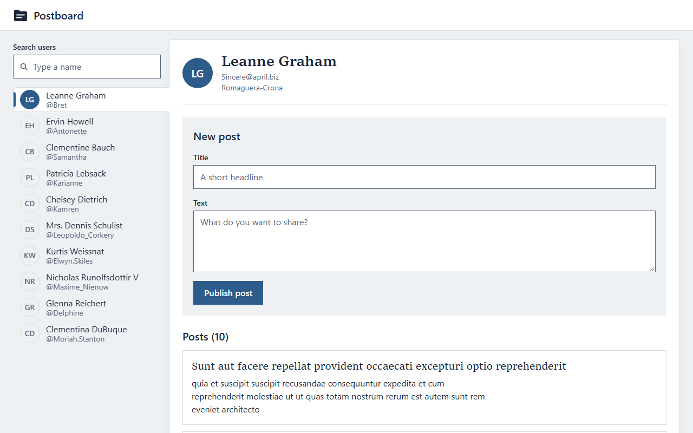

# Postboard

App pequeña en React 19 + TypeScript que usa [JSONPlaceholder](https://jsonplaceholder.typicode.com):
una lista de usuarios con búsqueda por nombre y, al elegir uno, sus publicaciones y un formulario
validado para crear una nueva. La API no guarda nada, así que los posts creados se guardan en
`localStorage` por usuario y sobreviven a una recarga.



## Requisitos

- **Node 24** (probado con 24.19.0).
- **pnpm 10.29.3**, la versión fijada en `packageManager`. Con Corepack se usa sola:

  ```sh
  corepack enable
  ```

## Cómo ejecutarlo

```sh
pnpm install        # dependencias (versiones publicadas hace al menos 24 h)
pnpm dev            # servidor de desarrollo en http://localhost:5173
pnpm build          # comprobación de tipos y build de producción en dist/
pnpm lint           # Oxlint (React hooks, TypeScript y jsx-a11y)
pnpm typecheck      # tsc -b sobre src/, e2e/ y la configuración
pnpm test           # tests unitarios y de integración (Vitest)
```

Tests E2E (Playwright, solo Chromium y sin interfaz):

```sh
pnpm exec playwright install --only-shell chromium   # una vez: el navegador headless
pnpm test:e2e                                        # hace el build y lo sirve con vite preview
```

Ningún test toca la red real: Vitest usa MSW, que falla ante cualquier petición sin handler, y
Playwright aborta todo lo que no vaya a `localhost` y sirve la API con datos fijos. Además,
Chromium arranca en los E2E con una regla de DNS que no resuelve ningún host salvo `localhost`:
ni siquiera una conexión (como el `preconnect` a la API) llega a salir.

> **Aviso:** publicar un post necesita un contexto seguro (`localhost` o HTTPS), porque cada post
> creado recibe un id local con `crypto.randomUUID()`, que el navegador solo ofrece ahí. Si abres
> `pnpm dev --host` desde el móvil por la IP de la red local (`http://192.168…`), la app carga,
> pero publicar falla siempre con «Couldn't publish the post».

## Decisiones y por qué

**Producto y estructura**

- **Maestro-detalle mobile-first.** En móvil se pasa de la lista al detalle con «Back to users»;
  desde `md`, dos columnas. Al cambiar de vista en móvil, el foco va al contenido nuevo.
- **Sin router.** La selección es estado de React; el enunciado no pide URLs y sería una
  dependencia más. Tras recargar hay que volver a elegir al usuario.
- **Carpetas por tipo** (`api/`, `hooks/`, `components/`, `lib/`): con dos funcionalidades, las
  carpetas por funcionalidad no aportan.
- **Formulario siempre visible** encima de los posts: un botón «New post» añadiría estado, foco y
  tests sin aportar al enunciado.
- **Posts creados en `localStorage`,** con una clave versionada por usuario
  (`postboard:created-posts:v1:{userId}`): los datos corruptos de uno no afectan a los demás.
  El post nuevo va arriba.

**Datos y React**

- **zod en las tres fronteras** (API, formulario y `localStorage`), con los tipos inferidos del
  esquema: el tipo y la validación no pueden desincronizarse. Se usa la API clásica de zod y no
  `zod/mini`, porque se lee mejor (ver «Qué haría con más tiempo»).
- **`fetch` y hooks propios con `useEffect` + `AbortController`.** Las peticiones obsoletas se
  cancelan y `res.ok === false` es un error. Sin `use()` + Suspense, que sin caché repetiría la
  petición.
- **Formulario con las actions de React 19:** `useActionState` (validación al enviar),
  `useFormStatus` (botón desactivado mientras publica, que evita el doble envío) y
  `useOptimistic` (el post aparece al instante y desaparece si el POST falla).
- **El POST no se cancela al cambiar de usuario:** el post existe, y se guarda para quien lo
  publicó con el `userId` capturado al enviar.
- **`startTransition` después del `await`:** React no trata como parte de la action lo que va
  tras un `await`, y sin él el post guardado y el optimista se veían a la vez con la misma
  `key`.
- **`useLayoutEffect` para el foco tras un error de validación:** el foco llega en el mismo
  render que las alertas; con `useEffect` había un instante con el foco perdido (un test
  intermitente lo descubrió).
- **StrictMode y la «compuerta» en los tests:** StrictMode monta los efectos dos veces en
  desarrollo. Un test comprueba que eso no hace parpadear un error, y el orden de las respuestas
  lo fija el test con una promesa, no con un `delay`.

**Interfaz**

- **Todos los textos en `src/i18n/messages.ts`,** sin librería de i18n: los componentes no los
  escriben y los tests los importan. Los textos con datos se prueban contra literales.
- **Dirección visual «Fichero de oficina»:** paleta cerrada en tokens de Tailwind v4, fuentes
  del sistema (sin red en los E2E) y un solo elemento memorable: el usuario seleccionado es una
  pestaña unida al panel de detalle. La cabecera es una barra con una marca en SVG decorativo, el
  contenido se centra con un ancho máximo de 80rem y el estado vacío del detalle lleva un icono.
- **Modo oscuro con `prefers-color-scheme`:** solo se redefinen las variables de color de `@theme`
  y `color-scheme: light dark`; ningún componente sabe que existe. Se midió cada par: el texto y
  los bordes de los controles, el foco y la barra de scroll pasan de 6,69:1 en oscuro.
  `index.html` declara `color-scheme` y un `theme-color` por tema. Sin selector de tema: sigue al
  sistema.
- **Accesibilidad:** contraste comprobado (bordes de los controles en 3:1, no solo el texto),
  foco visible, áreas táctiles de 44px, sin scroll horizontal a 320px, errores con
  `role="alert"` y cargas con `role="status"`. Las animaciones solo si el sistema no pide
  movimiento reducido.
- **`preconnect` al origen de la API** (con `crossorigin`, porque los `fetch` son CORS): el LCP en
  móvil es un nombre de la lista, que espera a `GET /users`.
- **El foco no se pierde tras una acción asíncrona:** después de publicar (o de fallar al
  publicar) vuelve al título, y tras «Try again» va al buscador o al título del usuario. Cada
  «Post published.» se anuncia, también el segundo.

**Forma de trabajar**

- **Commits atómicos:** cada commit hace una sola cosa, lleva su test y pasa por sí solo test,
  typecheck, lint y build. El prompt y el registro de IA de cada fase van en su propio commit de
  docs.
- **Seguridad de dependencias:** `minimumReleaseAge` de 24 h en pnpm, ningún paquete con scripts
  de instalación y `pnpm audit` sin vulnerabilidades.
- **E2E contra el build de producción** (`vite preview`) y no contra `pnpm dev`: se prueba lo que
  se entrega, sin los dobles efectos de StrictMode. El servidor nunca se reutiliza, para no
  probar un build viejo.

## Tests

| Capa | Tests | Archivos | Qué cubren |
| --- | --- | --- | --- |
| Unitarios | 36 | 19 | Cliente de la API, funciones puras, hooks con MSW y componentes que solo pintan |
| Integración | 14 | 4 | `UsersPanel`, `PostForm`, `PostsPanel` y `App` con sus piezas reales y MSW |
| E2E | 4 | 4 | Búsqueda, persistencia tras recargar, recuperación de un error y móvil a 320px |
| **Total** | **54** | **27** | |

- **Por qué este reparto:** la mayoría son unitarios porque son rápidos y señalan la pieza rota.
  La integración comprueba que las piezas encajan (formulario, optimista, foco), y los E2E solo
  los flujos que cruzan toda la app en un navegador real. Cada test defiende un comportamiento
  distinto: los errores HTTP, de red y la cancelación se prueban una sola vez, en `request`.
- **Casos que el enunciado no menciona y tienen su test:** respuestas obsoletas al cambiar rápido
  de usuario, dos posts con el mismo `id: 101`, doble clic en publicar, búsqueda con espacios o
  sin resultados, error solo en los posts, `localStorage` corrupto o bloqueado y cambiar de
  usuario con un POST pendiente.
- **Mutaciones para comprobar los tests:** cuando el rojo de una pieza era solo «falta el
  módulo», se rompía el código a propósito (sin comprobar `res.ok`, sin la señal, otra ruta, sin
  `trim()`…) y se comprobaba que fallaba el test que tocaba. Las mutaciones que sobrevivían se
  cubrieron con una aserción nueva o quedaron anotadas. En los E2E, cada spec se vio fallar con
  la app rota a propósito.

## Rendimiento y Lighthouse

Lighthouse 13.6.0 sobre el build de producción (`pnpm preview`), con la API real y el
estrangulamiento simulado de Lighthouse en móvil. En móvil, dos pasadas:

| | Móvil | Escritorio |
| --- | --- | --- |
| Rendimiento | 97–98 | 100 |
| LCP | 2,5 s | 0,2 s |
| CLS | 0 | 0 |
| TBT | 10–60 ms | 0 ms |
| Accesibilidad | 100 | 100 |
| Buenas prácticas | 100 | 100 |
| SEO | 100 | 100 |

- **Qué se arregló tras la primera medición:** un `robots.txt` (sin él, el fallback de la SPA
  devolvía `index.html` y el SEO daba 91) y el `preconnect` a la API (LCP en móvil de 2,6 a
  2,5 s; Lighthouse estimaba más ahorro del que dio).
- **El LCP en móvil es el nombre de un usuario** de la lista, así que depende de lo que tarde
  JSONPlaceholder. Lo pendiente está en «Qué haría con más tiempo».
- La categoría «Agentic Browsing» de Lighthouse 13 (`llms.txt`) no aplica a esta app.

## Qué haría con más tiempo

**Producto**

- **URL por usuario** con un router: así el botón «Atrás» del móvil volvería a la lista en vez de
  salir de la app. Y **sincronizar los posts entre pestañas** con el evento `storage`.
- **Ver un post que termina de publicarse después de volver a su usuario:** el panel nuevo ya leyó
  el storage y no lo ve hasta el siguiente montaje. Se resolvería con `useSyncExternalStore` sobre
  un pequeño almacén con suscripción.
- **Publicar sin contexto seguro:** un id local con `crypto.getRandomValues`, que sí existe fuera
  de HTTPS, en vez de `crypto.randomUUID()` (ver el aviso de arriba).
- **Otros idiomas:** una librería de i18n sobre `messages` (cada idioma con
  `satisfies typeof messages`) y un selector.

**Formulario y posts**

- Limpiar el error de un campo al editarlo, y que «Post published.» desaparezca al empezar el
  siguiente post.
- Bloquear los campos mientras se publica (`<fieldset disabled>`): si el POST falla, lo editado
  durante la espera se pierde.
- **«Posts (N)» fiable:** muestra 0 mientras cargan los posts de la API y, si su carga falla, solo
  cuenta los creados.
- `z.uuid()` para la `key` de los posts guardados, para que un storage manipulado no pueda repetir
  claves.

**Accesibilidad**

- **Foco al volver con un filtro activo:** si el usuario elegido ya no está en la lista filtrada,
  «Back to users» deja el foco en `body`.
- **Avisos de carga más fiables:** un contenedor `role="status"` fijo por panel en el que solo
  cambie el texto, porque una región viva que se inserta ya con texto no siempre se anuncia.
- **Una revisión con el modo de alto contraste de Windows** (`forced-colors`): la pestaña y la
  barra de acento dependen de fondos y de un pseudo-elemento.
- **View Transitions** entre la lista y el detalle, con la API nativa, detección y fallback, sin
  tocar la gestión del foco.

**Rendimiento**

- **`zod/mini`:** la medición dio +4,8 kB gzip frente a +23,8 kB de la API clásica, y es casi todo
  el JS sin usar que marca Lighthouse (53 KiB).
- **El CSS bloquea el primer pintado** (5 KB, unos 150 ms estimados en móvil): meter en el HTML el
  CSS crítico pide cambiar el build.
- **Bajar más el LCP en móvil:** pedir `GET /users` antes de montar React, en vez de esperar al JS.

**Código y tests**

- Registrar en consola los errores de carga (un cambio de forma de la API hoy no deja rastro), y
  que `useUserPosts` vuelva a `loading` al cambiar de usuario aunque no se remonte el panel.
- **El arranque en frío de los tests:** medir con `maxWorkers` limitado, `isolate: false` o un
  entorno más ligero que jsdom, en vez de subir tiempos de espera.
- Tests para el fallback de `isNarrowViewport` sin `matchMedia` y para el scroll horizontal a
  320px con posts largos; la **cobertura de tests** y los **E2E en CI**, con el informe y las
  trazas de los fallos.

## Cómo usé la IA

Usé Claude Code en todas las fases, con un plan aprobado antes de escribir código y una segunda
sesión de Claude como revisor de cada prompt y de cada salida antes de aprobar un commit. La
decisión final fue siempre mía. Los prompts están completos y literales en
[docs/prompts.md](docs/prompts.md), y el detalle de cada fase en [AI_LOG.md](AI_LOG.md).

- **Qué le pedí y qué acepté:** un plan por fases (P3–P9) con un commit por pieza y su test,
  ejecutado con TDD y parando antes de cada commit con el rojo, el diff y la salida real de los
  comandos. Acepté que comprobara cada test con mutaciones cuando el rojo era solo «falta el
  módulo», y que consultara la documentación actual (Context7) y guías de la plataforma web antes
  de escribir.
- **Corregí la forma de trabajar:** rechacé el primer commit, que mezclaba el scaffold, Tailwind y
  el prompt; desde entonces, commits atómicos y textos centralizados en `messages`.
- **Corregí decisiones técnicas:** validar con zod en vez de `res.json() as T`, y la API clásica
  de zod pese a que la IA recomendaba `zod/mini` con su medición.
- **Pedí arreglar causas, no síntomas:** una compuerta en vez de `delay(100)` en el test de
  StrictMode; `startTransition` en vez de filtrar el post duplicado; y `useLayoutEffect` en vez
  de esperar al foco en el test.
- **Detecté un test que no podía fallar:** los textos con datos se comparaban con la misma
  función rota de `messages`. Desde entonces se prueban contra literales.
- **En el diseño revisé cada pieza en el navegador** y cambié el plan: la regla 60-30-10, el avatar
  circular, la columna fija… Acepté los ajustes de contraste que midió la IA y rechacé su truco de
  `direction: rtl` para la barra de scroll.
- **En los E2E** decidí servir el build de producción, un interruptor en vez de contar peticiones
  para simular el error y descargar solo el navegador headless.
- **Al final pedí una revisión independiente** (otro agente sin el contexto de la sesión). De sus
  hallazgos, los tres importantes eran reales y la IA los comprobó en Chromium antes de
  arreglarlos: el segundo «Post published.» no se anunciaba y el foco caía en `body` tras publicar
  y tras «Try again». Aprobé esos arreglos y uno menor (nombrar la columna y el detalle para los
  lectores de pantalla); el resto de menores, valorados uno a uno, están arriba.
- **En la pasada final de diseño (P10)** aprobé cada retoque sobre capturas de antes y después, en
  claro y en oscuro, con el contraste de cada par medido por la IA. Aprobé una sola excepción a «los
  tests no se tocan»: el selector del E2E del `theme-color`, porque el HTML cambió de verdad. De
  Lighthouse, decidí hacer ya el `preconnect`, pero solo después de bloquear el DNS externo en los
  E2E para que siguieran sin tocar la red.

## Tiempo empleado

Suma de la duración de cada fase en [AI_LOG.md](AI_LOG.md). P1, P2 y P2b no tienen línea de
duración: salen de la hora de inicio de la fase siguiente.

| Fase | Inicio–fin | Minutos |
| --- | --- | --- |
| P1 — Reglas de trabajo | 09:53–10:17 | 24 |
| P2 — Plan | 10:17–10:31 | 14 |
| P2b — Revisión del plan | 10:31–10:57 | 26 |
| P3 — Scaffold y librerías | 10:57–12:09 | 72 |
| P4 — Capa de API | 12:12–13:27 | 75 |
| P5 — Usuarios, búsqueda y layout | 13:28–15:46 | 138 |
| P6 — Posts, formulario y persistencia | 15:50–18:32 | 162 |
| P7 — Pulido visual | 18:32–20:09 | 97 |
| P8 — Tests E2E | 20:09–20:49 | 40 |
| P9 — README y verificación | 20:49–21:37 | 48 |
| P10 — Retoques de diseño y Lighthouse | 21:49–22:28 | 39 |
| **Total** | | **735 (12 h 15 min)** |
